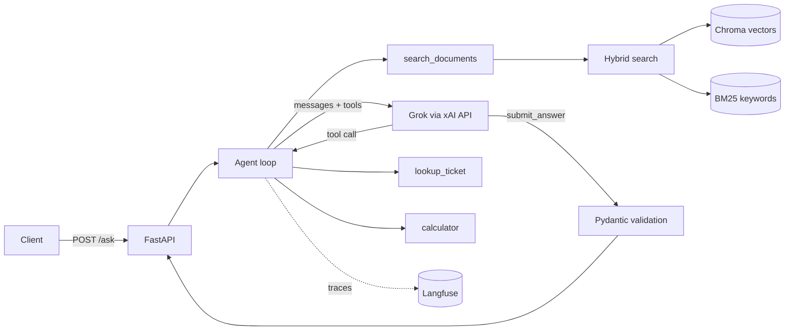

# CloudSync Document Q&A Agent

An AI agent that answers questions about a product's documentation, with **cited, structured answers**,
**every request traced in Langfuse**, and a **measured eval score**. It uses Grok (xAI) as the LLM.

## What it does

| Requirement | Where |
| --- | --- |
| RAG over documents (chunking, embeddings, vector DB, hybrid search) | `app/retrieval.py` (Chroma + BM25, fused with Reciprocal Rank Fusion) |
| Agent with extra tools | `app/tools.py`: `search_documents`, `lookup_ticket`, `calculator` |
| Hand-written agent loop (no framework) | `app/agent.py` |
| Structured, cited answers | `submit_answer` tool validated with Pydantic (`app/schemas.py`) |
| Observability | Langfuse: `@observe` spans plus the drop-in OpenAI wrapper (`app/tracing.py`) |
| API + container | FastAPI (`app/main.py`), `Dockerfile`, `docker-compose.yml` |
| Evals | `evals/` (23-question dataset, scoring, before/after comparison) |

## Architecture



**How a request flows:** the agent sends the question and tool descriptions to Grok. Grok never runs anything; it replies
with tool-call requests, our code runs them, and the results go back. The loop ends when Grok calls `submit_answer` with
`answer`, `citations`, `found_in_documents`, and `confidence`. That is validated against a schema; if invalid, the error is
returned to the model so it can fix it.

**Safety rails in the loop:** hard cap of `MAX_STEPS` (6); stops after 3 consecutive tool errors; tool errors are returned as
text so the model can recover; tool exceptions never crash the request; retrieved text is declared as data, not instructions
(prompt-injection hygiene); the calculator parses the expression instead of using `eval`. None of the tools are irreversible,
so no human confirmation step is needed. One would be added before any write/delete tool.

**Retrieval design:** markdown is split by heading first, then into ~800-character chunks with 120 overlap; each chunk carries
its heading. Pure vector search can miss exact tokens like `E-4021`, so BM25 keyword search runs alongside it and the two
rankings are merged with RRF. Embeddings run locally (MiniLM via Chroma), so only the LLM needs an API key.
If nothing relevant is found, the tool returns `NO_RESULTS` and the agent answers `found_in_documents=false` instead of guessing.

## Run it

### Option A: Docker (one command)

```bash
cp .env.example .env        # then put your Grok key in XAI_API_KEY (and Langfuse keys if you have them)
docker compose up --build
```

### Option B: local Python

```bash
python -m venv .venv && source .venv/bin/activate     # Windows: .venv\Scripts\activate
pip install -r requirements.txt
cp .env.example .env                                  # add XAI_API_KEY
python -m app.ingest                                  # builds the index (first run downloads a small embedding model)
uvicorn app.main:app --reload
```

### Try it

```bash
curl -s localhost:8000/ask -H 'content-type: application/json' \
  -d '{"question": "What does error E-4021 mean and how do I fix it?", "session_id": "demo-1"}'

curl -s localhost:8000/ask -H 'content-type: application/json' \
  -d '{"question": "How much do 8 Pro users cost for a year on annual billing?"}'
```

Interactive docs: http://localhost:8000/docs. Thumbs up/down: `POST /feedback {"trace_id": "...", "thumbs_up": true}`
(stored as a score on the trace).

The response contains the structured answer, each tool step, token usage, latency, and the Langfuse `trace_id`.

## Tracing with Langfuse

Create a free project at https://cloud.langfuse.com, copy the keys into `.env`
(`LANGFUSE_PUBLIC_KEY`, `LANGFUSE_SECRET_KEY`, `LANGFUSE_HOST`; use `https://us.cloud.langfuse.com` for the US region).
Each request becomes one trace: `doc-qa-agent` > LLM generations (model, tokens) + retriever/tool observations.
Requests with the same `session_id` are grouped as a session. Without keys, the app runs normally with tracing off.

> **Screenshot:** _add a screenshot of one trace here (`docs/trace.png`)_

## Evals

```bash
python -m evals.run_evals --label prompt-v1 --judge     # with PROMPT_VERSION=v1 in .env (baseline)
python -m evals.run_evals --label prompt-v2 --judge     # with PROMPT_VERSION=v2
python -m evals.compare prompt-v1 prompt-v2
python -m evals.upload_dataset                          # optional: copy the dataset into Langfuse
```

Per question it checks: completed (valid structured answer), keywords (expected facts present), citation (right source),
tool (expected tool used), abstain (unanswerable questions are declined), and an optional LLM-as-judge faithfulness score.
Scores are also attached to each Langfuse trace. Experiment knobs: `PROMPT_VERSION` (v1/v2), `RETRIEVAL_MODE`
(vector/keyword/hybrid), `TOP_K`.

### Results

> Fill this in with YOUR real numbers after running the commands above. Do not estimate.

| Run | Change | Pass rate | Keywords | Citation | Tool | Abstain | Faithful | Avg latency |
| --- | --- | --- | --- | --- | --- | --- | --- | --- |
| prompt-v1 | baseline prompt | _ | _ | _ | _ | _ | _ | _ |
| prompt-v2 | strict prompt (this repo's default) | _ | _ | _ | _ | _ | _ | _ |

**Improvement made:** _one or two sentences on what you changed, what moved, and which questions flipped
(`python -m evals.compare` lists them)._

## Tests

```bash
pytest -q     # calculator safety, chunking, hybrid retrieval, agent loop (with a fake LLM), API
```

## Answers to the Day 5 checks

- **What if retrieval returns nothing?** The tool returns `NO_RESULTS`; the prompt tells the agent to retry with different
  wording, then answer `found_in_documents=false` with no citations (the eval's `abstain` metric covers this).
- **Cost per request?** `usage` in the API response gives tokens (plus an estimated cost if `PRICE_IN_PER_M` /
  `PRICE_OUT_PER_M` are set). In Langfuse, open a trace to see per-generation tokens and cost, and the Dashboard for totals.
- **When to self-host a model?** Data-privacy requirements, very high volume where owning GPUs is cheaper than per-token
  pricing, or custom or fine-tuned models. Otherwise a hosted API avoids owning GPUs, scaling, and uptime.
- **Can someone run it with one command?** `docker compose up --build` after adding keys to `.env`.

## Project layout

```
app/        config, tracing, llm client, schemas, retrieval (RAG), tools, agent loop, FastAPI app
data/       sample documentation (docs/*.md) and tickets.json
evals/      dataset.json, run_evals.py, compare.py, upload_dataset.py
tests/      unit + integration tests (no network needed)
```

## Swapping in your own documents

Put `.md` files in `data/docs/`, run `python -m app.ingest` (or rebuild the Docker image), and update the example
questions in `evals/dataset.json`. Update the tool descriptions and prompt in `app/agent.py` if the domain changes.
